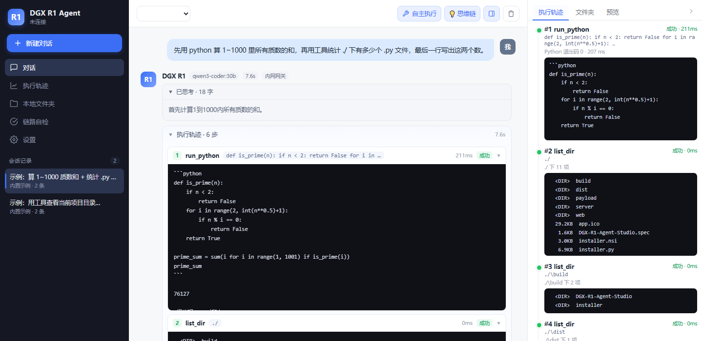
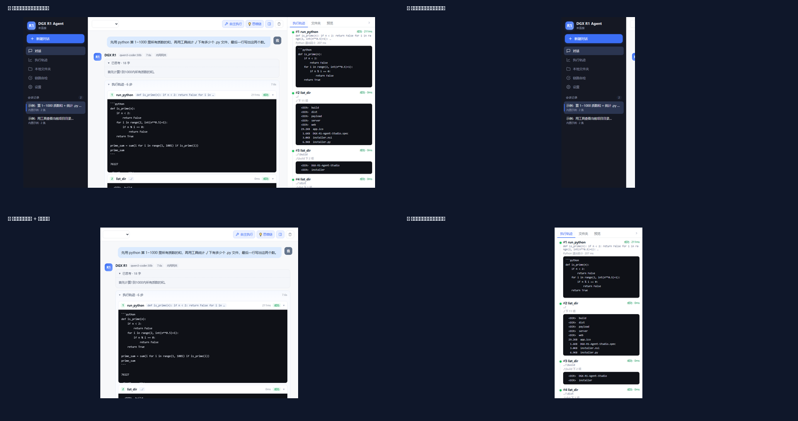
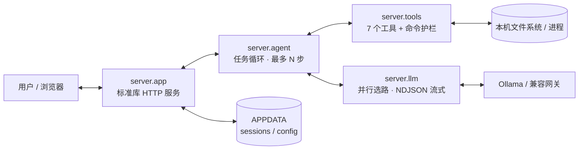

# R1 Agent Studio

> **一个能真正动手的、可完全离线部署的桌面智能体。**
> 列目录、读文件、写文件、跑命令、执行 Python —— 每一步的思考过程、代码和结果都在界面上可视、可展开、可复核。



| | |
|---|---|
| 版本 | v1.1.0 |
| 许可 | MIT |
| 运行依赖 | **Python 3.9+ 标准库，零第三方依赖**（`serve.py` 路径） |
| 模型 | 任意兼容 Ollama `/api/chat` 的模型，默认 `qwen3-coder:30b` |
| 平台 | Windows / Linux / macOS（服务端纯标准库） |
| 网络 | 默认只连 `127.0.0.1:11434`，**不联网也能用** |

---

## 一、为什么要做这个

通用聊天助手能"说"，但不能在你的机器上"做"。工业现场和工程开发里真正卡住的是三件事：

1. **数据出不了厂** —— 工艺视频、图纸、标注、日志不能上公有云，云端 Agent 直接出局。
2. **"说了"≠"做了"** —— 模型经常编造执行结果；没有工具调用轨迹，没法验收。
3. **部署太重** —— 一套 Agent 框架动辄 Python 环境 + 向量库 + 若干服务，车间/边缘盒子装不动。

R1 Agent Studio 的答案：**把 Agent 缩成一个本地 HTTP 服务 + 一个网页**，只依赖标准库，模型走本机 Ollama，所有执行过程逐帧可见。

---

## 二、核心特性

| 特性 | 说明 |
|---|---|
| **真·工具执行** | 7 个内置工具：`list_dir` / `read_file` / `write_file` / `run_cmd` / `run_python` / `search_text` / `fetch_url`；走 Ollama 原生 tool-calling，也兼容不支持工具的模型（自动降级为文本协议） |
| **过程全可视** | 左「会话」、中「思考链 + 代码块」、右「逐步执行轨迹」，每步显示耗时、参数、完整输出，可折叠 |
| **零依赖启动** | `python serve.py` 一条命令；不装 pywebview、不打包、不装任何 pip 包 |
| **多链路自动选路** | 并行探测所有配置的模型链路，选响应最快的可用链路；上一轮选中的优先复用 |
| **本地私有** | 默认只连本机 Ollama；不内置任何地址、令牌、账号；会话与配置只写本机 `APPDATA` |
| **命令护栏** | `tools.guard()` 拦截高危命令（格式化、递归删除等），工具执行超时可中断 |
| **思维链兼容** | 自动识别推理型模型（`r1` / `qwq` / `think` / `reason`），分别渲染思考过程与最终答案 |
| **内置真实示例** | 预置 2 条真实执行过的会话（6 步与 2 步工具调用），打开就能看到完整形态 |

---

## 三、快速开始

### 方式 A：零依赖 Web 版（推荐，任何平台）

```bash
# 1. 装好 Ollama 并拉一个模型
ollama pull qwen3-coder:30b        # 显存小可换 qwen2.5-coder:7b

# 2. 起服务
python serve.py

# 3. 浏览器打开 http://127.0.0.1:18600/
```

`serve.py` 只用标准库，会自动打开浏览器。不想自动开：

```bash
R1_NO_BROWSER=1 R1_PORT=18600 python serve.py
```

> 没有本地模型也能启动并浏览界面 / 使用文件工具，只是对话会提示"无可用链路"。
> 点左侧「链路自检」可看每条链路的探测明细。

### 方式 B：桌面原生窗口

```bash
pip install pywebview
python main.py
```

未安装 pywebview 时自动回落到系统默认浏览器。

### 方式 C：Windows 单文件 exe

从 Releases 下载 `DGX-R1-Agent-Studio.exe`（免安装）或 `Setup-v1.1.0.exe`（安装版）。
自行打包：

```bash
pip install pyinstaller
pyinstaller DGX-R1-Agent-Studio.spec
```

---

## 四、配置

**开源版默认只探测本机 Ollama**，不内置任何远程地址。需要接远程网关时用环境变量或配置文件注入。

| 环境变量 | 作用 | 默认 |
|---|---|---|
| `R1_PORT` | HTTP 监听端口 | `18600` |
| `R1_HOST` | 监听地址 | `127.0.0.1` |
| `R1_NO_BROWSER` | `1` = 不自动打开浏览器 | 自动打开 |
| `R1_GW_TOKEN` | 远程网关 Bearer Token（仅 `auth:true` 链路用） | 空 |
| `R1_ROUTES` | 链路配置的 JSON 数组，直接内联 | 空 |
| `R1_ROUTES_FILE` | 链路配置 JSON 文件路径 | `config/routes.json` |

链路配置格式见 [`config/routes.example.json`](config/routes.example.json)：

```json
[
  {"id": "local",  "label": "本机 Ollama", "base": "http://127.0.0.1:11434", "auth": false},
  {"id": "remote", "label": "我的网关",   "base": "https://your-gateway.example.com/node/dgx", "auth": true}
]
```

把示例文件复制成 `config/routes.json` 再改成自己的地址：

```bash
cp config/routes.example.json config/routes.json
```

> ⚠️ `config/routes.json`、`.env`、`*.token` 均已在 `.gitignore` 中 —— **任何凭据都不要提交进仓库**。
> 详见 [SECURITY.md](SECURITY.md)。

界面「设置」里可改模型、温度、最大步数（默认 8）、工作目录、系统提示词。

---

## 五、界面与使用过程



| 步骤 | 截图 | 看点 |
|---|---|---|
| ① 全界面 | [00_开源版真实运行.png](screenshots/00_开源版真实运行.png) | 一句自然语言任务 → 6 步工具调用 → 答案 |
| ② 左侧会话 | [01_会话列表与新建对话.png](screenshots/01_会话列表与新建对话.png) | 会话记录、新建对话、链路自检入口 |
| ③ 中间主区 | [02_思考过程与工具代码.png](screenshots/02_思考过程与工具代码.png) | 思考链、生成的 Python、执行输出 |
| ④ 右侧轨迹 | [03_执行轨迹面板.png](screenshots/03_执行轨迹面板.png) | 每一步的参数、耗时、成功/失败 |

补充材料：[作品封面](screenshots/10_作品封面.png) · [痛点说明](screenshots/11_痛点_制造业AI卡在三件事.png) · [价值说明](screenshots/12_价值_让AI落到产线.png)

一个典型任务（内置示例）：

> 「先用 python 算 1~1000 里所有质数的和，再用工具统计当前项目下有多少个 `.py` 文件，最后一行写出这两个数。」

Agent 会依次调用 `run_python` → `list_dir`，把每一步的代码与输出摊开，最终给出 `76127` 和文件数 —— **数字是工具算出来的，不是模型编的**。

---

## 六、架构



- `server/app.py`：`ThreadingHTTPServer`，静态资源 + REST API，`serve()` 返回 `(httpd, port)`
- `server/agent.py`：Agent 主循环，支持原生 tool-calling 与文本协议降级
- `server/tools.py`：工具实现、`guard()` 黑名单、输出截断
- `server/llm.py`：链路并行探测、模型能力识别、流式对话
- `web/`：无构建步骤的原生 HTML/CSS/JS 单页应用

详见 [架构与原理](docs/架构与原理.md) 与 [API 一览](docs/API.md)。

---

## 七、这个 Agent 的意义、同类对比、适用领域

**完整整理见 [`docs/03_定位与同类Agent对比及适用领域.md`](docs/03_定位与同类Agent对比及适用领域.md)** —— 包含与 AutoGPT / LangChain / OpenHands / Claude Code / Dify / n8n / MetaGPT 等 12 类框架的逐项对比、5 条差异化、以及「已落地 / 可延伸 / 不适合」三类领域清单。

一句话定位：

> 它不是"更聪明的通用 Agent"，而是**给工业现场与工程团队用的、能离线跑、过程可验收的轻量执行终端**。

---

## 八、安全与隐私

- 本仓库**不含任何真实内网地址、令牌、账号、主机名或生产配置**。所有远程链路均由使用者自行注入。
- `/api/state` 不回传真实主机名（开源版返回 `local`）。
- 工具执行有命令黑名单与超时；`fetch_url` 有输出长度上限。
- 请在**受信任的工作目录**下运行：`run_cmd` / `run_python` 具备当前用户权限，等价于你在终端里手动执行。
- 不要把本服务直接暴露到公网；默认只监听 `127.0.0.1`。

详见 [SECURITY.md](SECURITY.md)。

---

## 九、目录结构

```
r1-agent-studio/
├── serve.py                     # 零依赖启动器（推荐入口）
├── main.py                      # pywebview 桌面窗口入口
├── installer.py / *.spec        # Windows 单文件打包（可选）
├── server/
│   ├── app.py                   # HTTP 服务 + REST API
│   ├── agent.py                 # Agent 主循环
│   ├── tools.py                 # 7 个工具 + 命令护栏
│   └── llm.py                   # 多链路选路 + 流式对话（配置注入）
├── web/                         # 原生单页前端（无构建）
├── config/routes.example.json   # 链路配置示例（全是占位地址）
├── docs/                        # 快速开始 / 架构 / API / 定位对比 / 核验报告
├── screenshots/                 # 真实运行截图与使用过程
├── SECURITY.md / CHANGELOG.md
└── README.md
```

**启动核验**：模拟全新用户（临时 `APPDATA`）实测 **13/13 端点返回 200**，报告见 [docs/启动核验报告.md](docs/启动核验报告.md)。

---

## 十、路线图

- [x] 工具调用轨迹可视化、命令护栏、多链路自动选路
- [x] 零依赖 `serve.py`、开源脱敏、MIT 许可
- [ ] 工具权限白名单（按目录粒度）
- [ ] 会话导出 / 导入（JSON）
- [ ] 更多模型后端（OpenAI 兼容 `/v1/chat/completions`）
- [ ] Linux systemd / macOS launchd 常驻示例

---

## 十一、许可与致谢

MIT License，见 [LICENSE](LICENSE)。

模型能力由 [Ollama](https://ollama.com/) 及 Qwen 等开源模型提供。本项目只做**编排、执行与可视化**，不训练、不分发任何模型权重。

> ⚠️ 本项目为通用开源版本。工业现场的具体业务规则、标注体系、模型权重与产线配置**不在本仓库内**，也不属于本项目范围。
